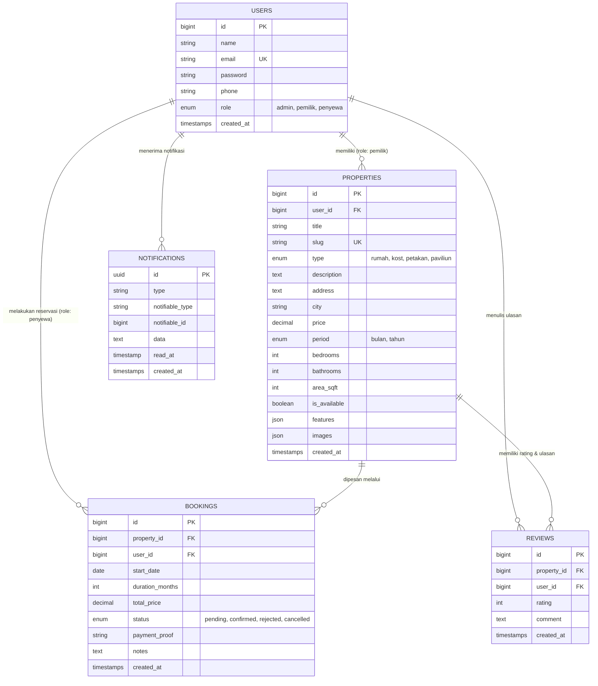

# 🏡 Booking Kontrakan & Kost

<p align="center">
  
  
  
  
  
  
  
</p>

Platform web modern untuk pencarian, pemesanan, dan pengelolaan sewa properti hunian end-to-end yang dibangun menggunakan **Laravel 12/13**, **Tailwind CSS**, dan **Alpine.js**. Aplikasi ini mendukung sistem multi-role (**Administrator**, **Pemilik Properti**, dan **Penyewa**) dengan alur booking transparan, sistem notifikasi in-app otomatis, panel kontrol khusus, serta konfigurasi serverless deployment ke **Vercel**.

---

## 📑 Daftar Isi

- [Fitur Utama](#-fitur-utama)
- [Arsitektur Role & Hak Akses](#-arsitektur-role--hak-akses)
- [Kategori Properti yang Didukung](#-kategori-properti-yang-didukung)
- [Tech Stack](#-tech-stack)
- [Kredensial Akun Demo (Quick Login)](#-kredensial-akun-demo-quick-login)
- [Panduan Instalasi & Menjalankan Lokal](#-panduan-instalasi--menjalankan-lokal)
- [Panduan Pengujian (Testing)](#-panduan-pengujian-testing)
- [Panduan Deployment ke Vercel](#-panduan-deployment-ke-vercel)
- [Struktur Database](#-struktur-database)
- [Struktur Direktori Proyek](#-struktur-direktori-proyek)
- [Riwayat Pembaruan (Changelog)](#-riwayat-pembaruan-changelog)

---

## ✨ Fitur Utama

### 1. 🔍 Katalog & Eksplorasi Properti
- **Pencarian Cerdas & Multi-Filter:** Filter berdasarkan kategori hunian (Rumah, Kost, Petakan, Paviliun), lokasi kota, dan rentang harga sewa.
- **Halaman Detail Interaktif:** Galeri foto hunian, deskripsi lengkap, rincian fasilitas (WiFi, AC, Parkir, Listrik, dll.), spesifikasi (kamar tidur, kamar mandi, luas tanah), alamat jelas, serta profil kontak pemilik via WhatsApp.
- **Sistem Rating & Ulasan:** Penyewa dapat memberikan testimoni dan rating bintang setelah menyewa.

### 2. 📅 Sistem Reservasi / Booking Terpadu
- **Pemesanan Mudah:** Penyewa memilih tanggal sewa mulai, durasi sewa fleksibel (hitungan bulan), dan catatan khusus.
- **Kalkulasi Biaya Otomatis:** Menghitung total biaya sewa secara instan sesuai durasi.
- **Upload Bukti Pembayaran:** Dukungan unggah gambar bukti transfer/pembayaran bank.
- **Pelacakan Status:** Riwayat pemesanan penyewa dengan indikator badge status (`Pending`, `Dikonfirmasi`, `Ditolak`, `Dibatalkan`).

### 3. 🔔 Sistem Notifikasi Real-Time untuk Pemilik
- **Trigger Otomatis:** Setiap kali ada penyewa yang melakukan booking hunian (Rumah Kontrakan, Kost Eksklusif, Kontrakan Petakan, atau Paviliun Mandiri), notifikasi database langsung dikirimkan ke akun pemilik properti terkait.
- **Navbar Notification Bell:** Dilengkapi badge counter unread notifikasi dan dropdown interaktif 5 notifikasi terbaru.
- **Halaman Pusat Notifikasi (`/owner/notifications`):** Tampilan daftar notifikasi lengkap dengan aksi:
  - Buka detail booking terkait
  - Tandai satu notifikasi sudah dibaca
  - Tandai semua notifikasi sudah dibaca
  - Hapus notifikasi

### 4. 🔑 Panel Manajemen Pemilik (Owner Panel)
- **Ringkasan Statistik:** Total properti terdaftar, total booking aktif, pemesanan pending butuh konfirmasi, dan estimasi pendapatan.
- **Manajemen Properti (CRUD):** Tambah hunian baru, edit spesifikasi & foto, atur status ketersediaan (*Tersedia* / *Penuh*), dan hapus data.
- **Manajemen Pemesanan:** Inspeksi bukti pembayaran penyewa, konfirmasi pesanan, atau tolak pesanan dengan alasan yang jelas.

### 5. 🛡️ Dashboard Administrator & Kontrol Izin Akun
- **Pusat Kontrol Khusus (`/admin`):** Dilengkapi middleware proteksi `admin`.
- **Rekapitulasi Sistem:** Total pengguna, total pemilik properti, total penyewa aktif, total hunian terdaftar, dan total transaksi booking.
- **Manajemen Izin Akun (Role Permission Management):**
  - **Beri Izin Pemilik (Grant Owner):** Mengubah peran pengguna dari Penyewa menjadi Pemilik properti agar dapat mendaftarkan huniannya.
  - **Cabut Izin Pemilik (Revoke Owner):** Mengembalikan peran Pemilik kembali menjadi Penyewa.
  - **Hapus Akun Pengguna:** Admin dapat menghapus akun yang melanggar ketentuan.
- **Kebijakan Pendaftaran Terkunci:** Form registrasi publik dikunci khusus untuk role **Penyewa**. Siapapun yang ingin menjadi Pemilik harus mendapatkan izin/verifikasi dari Administrator, mencegah spam properti.
- **Halaman Error 403 Forbidden Kustom:** Tampilan error ramah pengguna dengan tombol navigasi cepat jika non-admin mencoba mengakses halaman terlarang.

### 6. 👤 Manajemen Profil & Keamanan Pengguna
- Edit informasi data diri (nama, alamat email, nomor WhatsApp).
- Ganti kata sandi dengan validasi kata sandi saat ini (*current password*).
- Tombol **Quick Login 1-Klik** untuk kemudahan testing akun Admin, Pemilik, dan Penyewa.

---

## 👥 Arsitektur Role & Hak Akses

| Hak Akses / Kemampuan | Penyewa (`penyewa`) | Pemilik (`pemilik`) | Administrator (`admin`) |
| :--- | :---: | :---: | :---: |
| Jelajah & Cari Properti | ✅ | ✅ | ✅ |
| Melakukan Booking & Upload Bukti Bayar | ✅ | ❌ | ❌ |
| Memberikan Rating & Ulasan | ✅ | ❌ | ❌ |
| Riwayat Booking Pribadi | ✅ | ❌ | ❌ |
| Manajemen Profil & Sandi | ✅ | ✅ | ✅ |
| Kelola Properti Milik Sendiri (CRUD) | ❌ | ✅ | ✅ |
| Konfirmasi & Tolak Booking Masuk | ❌ | ✅ | ✅ |
| Menerima Notifikasi Pemesanan Baru | ❌ | ✅ | ✅ |
| Akses Dashboard Admin (`/admin`) | ❌ | ❌ | ✅ |
| Beri / Cabut Izin Akun Pemilik | ❌ | ❌ | ✅ |
| Hapus Akun Pengguna | ❌ | ❌ | ✅ |

---

## 🏘️ Kategori Properti yang Didukung

Aplikasi mengakomodasi 4 jenis hunian sewa dengan spesifikasi yang disesuaikan:

1. **🏠 Rumah Kontrakan (`rumah`):**
   Hunian satu rumah penuh untuk keluarga atau kelompok. Dilengkapi kamar tidur banyak, ruang tamu, dapur mandiri, carport, dan halaman.
2. **🛏️ Kost Eksklusif (`kost`):**
   Kamar sewa modern full-furnished (AC, WiFi kencang, kamar mandi dalam, kasur springbed, water heater) untuk mahasiswa dan pekerja.
3. **🧱 Kontrakan Petakan (`petakan`):**
   Hunian sewa praktis dan ekonomis dengan sekat 3 ruang (ruang depan, kamar tidur, area dapur/kamar mandi pribadi).
4. **🏡 Paviliun Mandiri (`paviliun`):**
   Unit hunian paviliun terpisah dengan privasi tinggi, meteran listrik terpisah, dan akses pagar tersendiri.

---

## 🛠️ Tech Stack

- **Core Framework:** [Laravel 12 / 13](https://laravel.com)
- **Bahasa Pemrograman:** [PHP 8.4+](https://www.php.net)
- **Database:** MySQL 8.0+
- **Styling:** [Tailwind CSS v3 CDN](https://tailwindcss.com) + [@tailwindcss/typography](https://tailwindcss.com/docs/typography-plugin)
- **JavaScript UI:** [Alpine.js v3 CDN](https://alpinejs.dev) (Reaktivitas modal, dropdown notifikasi, dan mobile navbar)
- **Notifikasi:** Laravel Database Notification System
- **Testing:** PHPUnit & Feature Testing (27 passing test cases)
- **Deployment Platform:** [Vercel](https://vercel.com) (Serverless PHP Runtime `vercel-php@0.9.0`)

---

## 🔑 Kredensial Akun Demo (Quick Login)

Untuk keperluan review dan pengujian, Anda dapat menggunakan tombol **Quick Login 1-Klik** di halaman `/login` atau login manual dengan akun berikut:

| Peran (Role) | Email | Password | Hak Akses Utama |
| :--- | :--- | :--- | :--- |
| **🛡️ Administrator** | `admin@kontrakan.test` | `password` | Akses `/admin`, kelola izin role pemilik, hapus user |
| **🔑 Pemilik Properti** | `pemilik@kontrakan.test` | `password` | Akses `/owner`, kelola 9 properti hunian, notifikasi booking |
| **👤 Penyewa (Tenant)** | `budi@gmail.com` | `password` | Akses katalog, booking hunian, riwayat, ulasan |

---

## 💻 Panduan Instalasi & Menjalankan Lokal

### Prasyarat Sistem
- PHP >= 8.2 (Disarankan PHP 8.4)
- Composer >= 2.x
- MySQL Database Server (Laragon, XAMPP, atau Docker)

### Langkah Instalasi

1. **Clone repositori:**
   ```bash
   git clone https://github.com/farihanzahri3899-hash/Booking-Kontrakan.git
   cd Booking-Kontrakan
   ```

2. **Instal dependensi PHP:**
   ```bash
   composer install
   ```

3. **Salin environment configuration:**
   ```bash
   cp .env.example .env
   ```

4. **Generate Application Key:**
   ```bash
   php artisan key:generate
   ```

5. **Konfigurasikan Database di file `.env`:**
   ```env
   DB_CONNECTION=mysql
   DB_HOST=127.0.0.1
   DB_PORT=3306
   DB_DATABASE=booking_kontrakan
   DB_USERNAME=root
   DB_PASSWORD=
   ```

6. **Jalankan Migrasi & Seeder Data Demo:**
   ```bash
   php artisan migrate:fresh --seed
   ```
   *Perintah ini akan membuat semua tabel, seeder akun demo (Admin, Pemilik, Penyewa), 9 properti hunian contoh, dummy booking, dan dummy ulasan.*

7. **Buat Symlink Storage (untuk upload gambar bukti bayar & properti):**
   ```bash
   php artisan storage:link
   ```

8. **Jalankan Server Development:**
   ```bash
   php artisan serve
   ```
   Buka peramban di `http://127.0.0.1:8000`.

---

## 🧪 Panduan Pengujian (Testing)

Aplikasi dilengkapi dengan rangkaian Feature Tests komprehensif menggunakan PHPUnit:

```bash
php artisan test
```

### Rincian Cakupan Test:
- **`AdminDashboardTest` (6 tests):**
  - Akses Dashboard Admin oleh akun dengan role Admin
  - Pemblokiran akses (403) untuk Penyewa dan Pemilik ke Dashboard Admin
  - Pemberian izin Pemilik (*grant owner*) oleh Admin
  - Pencabutan izin Pemilik (*revoke owner*) oleh Admin
  - Pendaftaran publik hanya menghasilkan role Penyewa
  - Verifikasi keamanan pembersihan akun
- **`BookingNotificationTest` (6 tests):**
  - Pengiriman notifikasi otomatis ke pemilik saat booking dibuat
  - Penghitungan unread notification count
  - Notifikasi mencakup tipe hunian lengkap (Rumah, Kost, Petakan, Paviliun)
  - Akses halaman notifikasi pemilik
  - Fitur tandai notifikasi sebagai sudah dibaca (*mark as read*)
  - Fitur hapus notifikasi
- **`BookingKontrakanTest` (14 tests):**
  - Alur autentikasi, registrasi penyewa, dan quick login 3 peran
  - Katalog properti, filter harga, filter kota, dan filter kategori
  - Alur booking hunian dengan kalkulasi biaya dan upload bukti transfer
  - Ulasan properti dan rating bintang
  - CRUD properti oleh pemilik di Owner Panel
  - Update profil pengguna dan ubah password

---

## 🚀 Panduan Deployment ke Vercel

Repositori ini telah dikonfigurasi untuk deployment ke Vercel Serverless Function menggunakan runtime `vercel-php@0.9.0`.

### Konfigurasi yang Tersedia:
- `vercel.json`: Menentukan `"outputDirectory": "public"`, runtime PHP, dan routing rewrite.
- `api/index.php`: Entrypoint serverless yang otomatis menyiapkan direktori cache/storage di `/tmp/storage` runtime Lambda.
- `.vercelignore`: Mengecualikan file dev, dependensi lokal, dan file temporary.

### Langkah Deploy:

1. **Push kode ke repositori GitHub:**
   ```bash
   git add .
   git commit -m "feat: siap deploy ke vercel"
   git push origin main
   ```

2. **Impor Proyek di Vercel Dashboard:**
   - Kunjungi [Vercel Dashboard](https://vercel.com/dashboard) -> **Add New Project**.
   - Pilih repositori `Booking-Kontrakan`.

3. **Atur Environment Variables di Vercel Settings:**
   Tambahkan variabel berikut pada menu **Settings > Environment Variables**:
   ```env
   APP_NAME="Booking Kontrakan"
   APP_ENV=production
   APP_DEBUG=false
   APP_URL=https://nama-proyek-anda.vercel.app
   APP_KEY=base64:... (ambil dari php artisan key:generate)

   # Database MySQL Online (Supabase, PlanetScale, Aiven, TiDB, atau AWS RDS)
   DB_CONNECTION=mysql
   DB_HOST=your-db-host.com
   DB_PORT=3306
   DB_DATABASE=your_database
   DB_USERNAME=your_username
   DB_PASSWORD=your_password

   # Session, Cache & Queue Driver (Gunakan database atau cookie di serverless)
   SESSION_DRIVER=cookie
   CACHE_STORE=array
   QUEUE_CONNECTION=sync
   ```

4. **Klik Deploy.**

---

## 🗄️ Struktur Database



---

## 📁 Struktur Direktori Proyek

```
Booking-Kontrakan/
├── api/
│   └── index.php                        # Entry point serverless untuk Vercel
├── app/
│   ├── Http/
│   │   ├── Controllers/
│   │   │   ├── Admin/
│   │   │   │   └── AdminDashboardController.php  # Kelola statistik & izin akun
│   │   │   ├── Owner/
│   │   │   │   ├── BookingManageController.php   # Konfirmasi / tolak pesanan
│   │   │   │   ├── DashboardController.php       # Ringkasan analitik pemilik
│   │   │   │   ├── NotificationController.php    # Pusat notifikasi pemilik
│   │   │   │   └── PropertyManageController.php  # CRUD properti
│   │   │   ├── AuthController.php                # Login, Register Penyewa, Quick Login
│   │   │   ├── BookingController.php             # Form & aksi booking penyewa
│   │   │   ├── HomeController.php                # Halaman muka & statistik
│   │   │   ├── ProfileController.php             # Update info profil & password
│   │   │   ├── PropertyController.php            # Katalog & filter properti
│   │   │   └── ReviewController.php              # Ulasan & penilaian
│   │   └── Middleware/
│   │       ├── EnsureUserIsAdmin.php             # Proteksi hak akses admin
│   │       └── EnsureUserIsOwnerOrAdmin.php      # Proteksi panel pemilik
│   ├── Models/
│   │   ├── Booking.php
│   │   ├── Property.php
│   │   ├── Review.php
│   │   └── User.php
│   ├── Notifications/
│   │   └── NewBookingNotification.php            # Database notif booking baru
│   └── Providers/
│       └── AppServiceProvider.php                # View Composer notifikasi navbar
├── database/
│   ├── migrations/                               # Skema tabel database
│   └── seeders/
│       ├── DatabaseSeeder.php
│       ├── PropertySeeder.php
│       └── UserSeeder.php                        # Seeder akun demo & 9 properti
├── resources/
│   └── views/
│       ├── admin/
│       │   └── dashboard.blade.php               # Halaman Pusat Kontrol Admin
│       ├── auth/
│       │   ├── login.blade.php                   # Form login + 3 Quick Login demo
│       │   └── register.blade.php                # Form registrasi khusus penyewa
│       ├── errors/
│       │   └── 403.blade.php                     # Halaman kustom 403 Forbidden
│       ├── layouts/
│       │   └── app.blade.php                     # Shell layout + Bell notif & Alpine nav
│       ├── owner/
│       │   ├── bookings/                         # Tampilan kelola booking
│       │   ├── notifications/                    # Tampilan pusat notifikasi
│       │   └── properties/                       # Tampilan CRUD properti
│       ├── properties/                           # Katalog & detail properti
│       └── profile/                              # Form profil & ganti sandi
├── tests/
│   └── Feature/
│       ├── AdminDashboardTest.php                # Test admin panel & kontrol izin
│       ├── BookingNotificationTest.php           # Test sistem notifikasi pemilik
│       └── BookingKontrakanTest.php              # Test flow utama booking & katalog
├── vercel.json                                   # Konfigurasi deploy Vercel
└── README.md
```

---

## 📜 Riwayat Pembaruan (Changelog)

### **v2.0 (Pembaruan Terkini)**
- **🛡️ Admin Panel & Kontrol Hak Akses:**
  - Penambahan `AdminDashboardController` dan halaman tampilan `admin.dashboard`.
  - Fitur **Beri Izin Pemilik** (*Grant Owner*) dan **Cabut Izin Pemilik** (*Revoke Owner*).
  - Fitur hapus akun oleh Administrator.
  - Penambahan middleware `EnsureUserIsAdmin` dengan alias `admin`.
- **🔒 Kebijakan Registrasi Khusus Penyewa:**
  - Form registrasi publik dikunci hanya untuk role `penyewa` (opsi daftar mandiri pemilik ditiadakan demi keamanan platform).
  - Pengguna yang ingin menjadi pemilik properti harus mendapatkan persetujuan/izin dari Admin.
- **🚫 Custom 403 Forbidden Page:**
  - Tampilan elegan jika pengguna non-pemilik / non-admin mencoba mengakses halaman terproteksi.
- **⚡ Pembaruan Quick Login Demo:**
  - Tombol 1-klik kini mencakup 3 peran lengkap: Administrator, Pemilik, dan Penyewa.

### **v1.3**
- **🔔 Sistem Notifikasi Pemilik Terintegrasi:**
  - Pembuatan migration tabel `notifications`.
  - Kelas notifikasi `NewBookingNotification` yang mencakup 4 tipe hunian (Rumah, Kost, Petakan, Paviliun).
  - View Composer di `AppServiceProvider` untuk counter unread badges dan preview 5 notif terakhir di navbar.
  - Controller & UI pusat notifikasi pemilik (`/owner/notifications`).

### **v1.2**
- **☁️ Vercel Serverless Ready:**
  - Penambahan file konfigurasi `vercel.json` dengan `"outputDirectory": "public"` dan runtime `vercel-php@0.9.0`.
  - Pembuatan handler serverless `api/index.php` untuk penyimpanan dinamis `/tmp/storage`.
  - Penyesuaian konfigurasi cache dan sessions untuk arsitektur serverless.

### **v1.1**
- **👤 Manajemen Profil & Keamanan:**
  - Penambahan fitur edit data profil (nama, email, nomor HP).
  - Penambahan fitur pergantian password terverifikasi.

### **v1.0**
- **🚀 Rilis Awal Sistem Booking Kontrakan:**
  - Model & migrasi data: `User`, `Property`, `Booking`, `Review`.
  - 4 Kategori properti hunian: Rumah Kontrakan, Kost Eksklusif, Kontrakan Petakan, Paviliun Mandiri.
  - Katalog properti dengan multi-filter (kategori, lokasi, harga).
  - Alur booking hunian dengan kalkulasi biaya otomatis dan upload bukti transfer.
  - Panel pemilik hunian (Dashboard, CRUD properti, konfirmasi booking).
  - UI responsif modern berbasis Tailwind CSS & Alpine.js.

---

## 📄 Lisensi

Proyek ini merupakan perangkat lunak sumber terbuka yang dilisensikan di bawah [MIT License](LICENSE).
